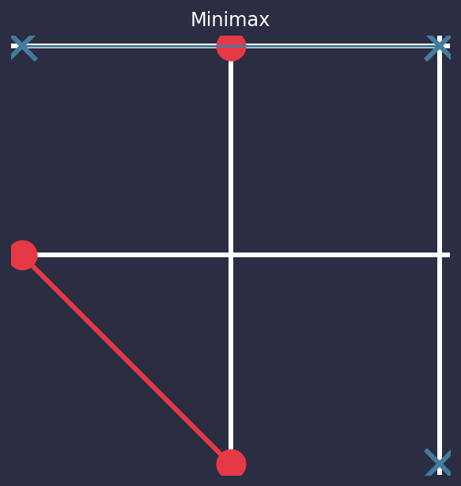

**Data de criação do código:** 22 de outubro de 2023

# Jogo da Velha (Minimax)



Jogo da velha com IA minimax modularizada em `TicTacToe/`.

## Como executar

Arquivo(s) principal(is): `TicTacToe/main.R`.

```r
# Abra o projeto no RStudio ou, para Shiny:
# setwd(".../Jogo da Velha")
# source("main.R")  # quando aplicável
```

## Stack

R

## Estrutura

- Código e notebooks na raiz ou subpastas do diretório do projeto.
- Imagem de capa: `docs/preview.png` (gerada ou copiada de saídas do próprio trabalho).
- Credenciais/dados privados: pasta `secrets/` (ver `SECRETS.md` na raiz do workspace, se existir).

## Licença

Uso acadêmico/pessoal. Ajuste a licença antes de publicar no GitHub.

